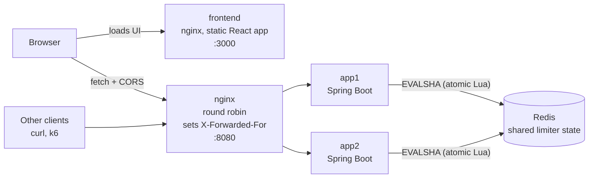
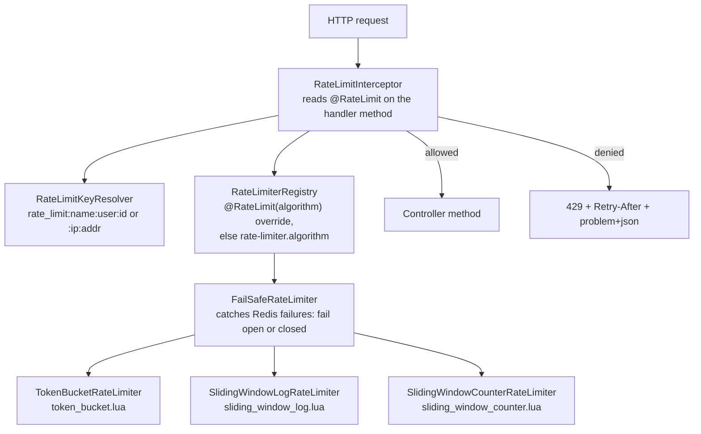
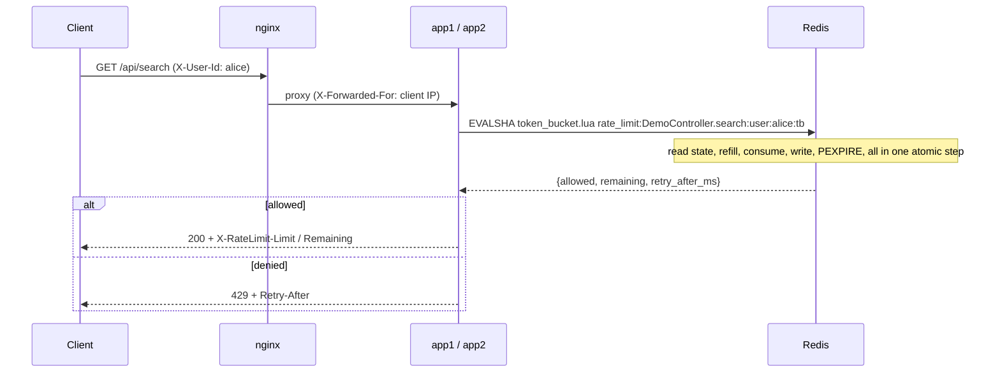

# Distributed Rate Limiter

A Redis-backed rate limiter for Spring Boot 3 (Java 17). Annotate a controller method with
`@RateLimit` and the limit holds across **every instance** of the application, because all state
lives in Redis and every check runs as a single atomic Lua script. A small React app, the
**Rate Limiter Playground**, lets you fire bursts at the API and watch the three algorithms behave differently.

```java
@RateLimit(capacity = 5, refillRate = 5, unit = ChronoUnit.MINUTES, key = KeyType.USER)
@GetMapping("/api/search")
public SearchResponse search(@RequestParam String q) { ... }
```

```
HTTP/1.1 429 Too Many Requests
X-RateLimit-Limit: 5
X-RateLimit-Remaining: 0
Retry-After: 11
Content-Type: application/problem+json

{"type":"about:blank","title":"Too Many Requests","status":429,
 "detail":"Rate limit exceeded. Retry after 11 second(s).","path":"/api/search","retryAfterSeconds":11}
```

## Features

- **`@RateLimit` annotation**: capacity, refill rate and period, keyed **per user** (`X-User-Id` header) or **per client IP**.
- **Three algorithms** behind one `RateLimiter` interface (strategy pattern): token bucket, sliding window log and sliding window counter. The default is chosen in `application.yml`; an endpoint can override it with `@RateLimit(algorithm = …)`.
- **Atomic Redis Lua scripts**, so limits are exact under concurrency and across instances.
- **Standard responses**: HTTP 429 with `X-RateLimit-Limit`, `X-RateLimit-Remaining`, `Retry-After` and an RFC 7807 `application/problem+json` body.
- **Configurable fail-open or fail-closed** when Redis is unavailable, with rate-limited logging and a recovery message.
- **Spoof-resistant client IPs**: `X-Forwarded-For` is trusted only from internal proxies.
- **Tested end to end**:
  - unit tests (JUnit 5, Mockito);
  - Testcontainers integration tests against real Redis;
  - a 1000-concurrent-request test across two instances;
  - a JaCoCo coverage gate;
  - a k6 load test.
- **Rate Limiter Playground**: a React + Vite + TypeScript UI. It sends bursts and shows each request as allowed or blocked, plus the rate limit headers. It can compare all three algorithms side by side.
- **Browser-ready API**: CORS with configurable origins, and the rate limit headers exposed to JavaScript.
- **Runs locally as a distributed setup**: Docker Compose with two instances behind nginx, Redis, and the playground.
- **CI**: GitHub Actions builds, tests on JDK 17 and 21, tests and builds the frontend, publishes coverage, builds both images and smoke-tests the compose stack.

## Architecture



Inside each instance, a request passes through these layers:





### Code layout

| Package | Contents |
|---|---|
| `annotation` | `@RateLimit`, `KeyType` |
| `core` | `RateLimiter` (strategy interface), `RateLimitRule`, `RateLimitResult`, `Algorithm` |
| `algorithm` | The three Redis implementations, `FailSafeRateLimiter` (decorator), `RateLimiterRegistry` (per-endpoint choice) and `LuaReplies` |
| `config` | `RateLimiterProperties` (typed `rate-limiter.*` config), algorithm selection, Redis client options |
| `web` | `RateLimitInterceptor`, `RateLimitKeyResolver`, `WebConfig` (interceptor + CORS), `CorsProperties` |
| `demo` | `DemoController` (example API), `PlaygroundController` (algorithm endpoints and endpoint catalog) |
| `src/main/resources/scripts` | `token_bucket.lua`, `sliding_window_log.lua`, `sliding_window_counter.lua` |
| `frontend/` | The playground: React + Vite + TypeScript, plain CSS (see [Rate Limiter Playground](#rate-limiter-playground)) |

## Getting started

**Requirements:** Java 17+ and Docker. Node.js 24 is only needed to work on the frontend outside Docker. Maven is not needed: use the included wrapper (`./mvnw`, or `.\mvnw.cmd` on Windows).

### Run everything: 2 instances + nginx + Redis + playground

```bash
docker compose up --build -d --wait
```

- **Playground UI:** http://localhost:3000
- **API (through nginx):** http://localhost:8080

From the command line, send seven searches as alice:

```bash
for i in 1 2 3 4 5 6 7; do curl -s -o /dev/null -w "%{http_code} " -H "X-User-Id: alice" "http://localhost:8080/api/search?q=redis"; done
```

You get `200 200 200 200 200 429 429`. nginx alternates between `app1` and `app2` (see the `X-Upstream`
response header and the `instance` field in the body), but the limit of 5 is shared.

Choose the algorithm with an environment variable, then restart:

```bash
RATE_LIMITER_ALGORITHM=sliding-window-log docker compose up -d --wait
```

```bash
docker compose down
```

### Run the app locally

With Redis on `localhost:6379`, for example from `docker run -d -p 6379:6379 redis:7.4-alpine`:

```bash
./mvnw spring-boot:run
```

### Demo endpoints

| Endpoint | Limit | Keyed by |
|---|---|---|
| `GET /api/ping` | burst of 10, then 5 per second | client IP |
| `GET /api/search?q=` | 5, then 5 per minute | `X-User-Id` |
| `POST /api/reports` | 2, then 1 per minute | `X-User-Id` |
| `GET /api/playground/token-bucket` | burst of 10, then 2 per second, always **token bucket** | `X-User-Id` |
| `GET /api/playground/sliding-window-log` | same limit, always **sliding window log** | `X-User-Id` |
| `GET /api/playground/sliding-window-counter` | same limit, always **sliding window counter** | `X-User-Id` |
| `GET /api/playground/endpoints` | not limited: lists every `@RateLimit` endpoint with its limit and effective algorithm | |
| `GET /actuator/health` | not limited | |

The demo endpoints follow `rate-limiter.algorithm`. The three playground endpoints override it, so they can be
compared side by side.

### Configuration

| Property | Default | Meaning |
|---|---|---|
| `rate-limiter.enabled` | `true` | Master switch |
| `rate-limiter.algorithm` | `token-bucket` | `token-bucket`, `sliding-window-log` or `sliding-window-counter` (env: `RATE_LIMITER_ALGORITHM`) |
| `rate-limiter.fail-open` | `true` | When Redis is unavailable: `true` allows requests, `false` rejects them with 429 and `Retry-After: 1` |
| `rate-limiter.key-prefix` | `rate_limit` | Prefix for every Redis key |
| `spring.data.redis.host` / `port` | `localhost` / `6379` | env: `REDIS_HOST` / `REDIS_PORT` |
| `spring.data.redis.timeout` / `connect-timeout` | `500ms` | How long a Redis outage can delay a request before fail-open or fail-closed applies |
| `app.cors.allowed-origins` | `http://localhost:5173,http://localhost:3000` | Browser origins allowed to call `/api/**`: the Vite dev server and the compose UI (env: `APP_CORS_ALLOWED_ORIGINS`, comma-separated) |

Invalid values, such as an unknown algorithm or a blank prefix, stop the application at startup.

### `@RateLimit` attributes

| Attribute | Default | Meaning |
|---|---|---|
| `capacity` | required | Maximum burst (token bucket) or requests per window (window algorithms) |
| `refillRate` | required | Tokens restored every `refillPeriod` |
| `refillPeriod`, `unit` | `1`, `SECONDS` | Length of a refill period |
| `key` | `IP` | `USER` (the `X-User-Id` header; falls back to IP if missing or invalid) or `IP` |
| `name` | `Class.method` | Limit name in the Redis key; endpoints with the same name share a limit |
| `algorithm` | `{}` (use `rate-limiter.algorithm`) | Algorithm for this endpoint only, e.g. `algorithm = Algorithm.SLIDING_WINDOW_LOG`. It's an array only because annotations can't default to `null`; at most one value. |

The window algorithms use a window of `capacity / refillRate × refillPeriod`, so **all three
enforce the same sustained rate**. Changing the algorithm changes only how bursts are handled.

## Rate Limiter Playground

A small React app in [`frontend/`](frontend) for demoing the limiter visually.

<!-- Screenshot placeholder: save a screenshot of compare mode after one burst as docs/playground.png,
     then uncomment the line below. -->
<!--  -->

> **Screenshot placeholder:** add `docs/playground.png` (compare mode after one burst works well) and
> uncomment the image line above this note in the README source.

### What it does

- **Single endpoint mode.** Pick any rate-limited endpoint, set a user ID (or click **New user** for a fresh bucket), choose how many requests (default 50) and how fast (all at once, or 2–50 per second), then **Send burst**.
  - A grid fills in live with one square per request, in send order: **green** = 200, **red** = 429, amber = error, dashed = not sent (after **Stop**).
  - Counters show allowed and blocked, plus the latest `X-RateLimit-Remaining` and `Retry-After`. Each square's tooltip has that request's status, headers and time.
- **Compare algorithms mode.** Sends the same burst at the same moment to the three `/api/playground/*` endpoints. They share one limit (burst of 10, then 2/s per user) and differ only in algorithm. Each run uses a new user ID so all three start equal.

The endpoint list comes from `GET /api/playground/endpoints`, so the UI always shows the limits the code
actually enforces.

**What you should see** (50 requests at 10/s, measured against the compose stack):

| Algorithm | Allowed | What happens after the burst of 10 |
|---|---|---|
| Token bucket | 19 | A steady trickle: 1 in every 5 requests, as tokens refill at 2/s |
| Sliding window log | 10 | Nothing: no request leaves the 5 s window before the burst ends |
| Sliding window counter | 11–17 | In between. It varies run to run because its fixed 5 s windows follow the clock, so the result depends on where the burst falls. |

### Run it

**With Docker** (everything): `docker compose up --build -d --wait`, then open http://localhost:3000.

**For frontend development** (hot reload). Start Redis and the API, then the Vite dev server:

```bash
docker run -d -p 6379:6379 redis:7.4-alpine
```

```bash
./mvnw spring-boot:run
```

```bash
cd frontend && npm install && npm run dev
```

Open http://localhost:5173.

| Frontend command (in `frontend/`) | What it does |
|---|---|
| `npm run dev` | Vite dev server on :5173 |
| `npm test` | Vitest unit tests (API client, burst scheduling, formatting) |
| `npm run typecheck` | TypeScript, strict mode |
| `npm run build` | Production build into `dist/` |

**Pointing the UI at another API.** The API URL is fixed at build time (`VITE_API_BASE_URL`, default
`http://localhost:8080`), because Vite inlines `VITE_*` variables into the JavaScript. With compose, set
`PLAYGROUND_API_URL` when building, and add the UI's origin to `APP_CORS_ALLOWED_ORIGINS` on the API.

### How the browser is allowed in (CORS)

The UI (`:3000` or `:5173`) and the API (`:8080`) are different origins, so the API sends CORS headers for `/api/**`:

- **Allowed origins** come from `app.cors.allowed-origins`. Only these exact origins are allowed, never `*`.
- **`Access-Control-Expose-Headers: X-RateLimit-Limit, X-RateLimit-Remaining, Retry-After`.** Without it, the browser hides those headers from JavaScript even on successful responses.
- **Preflight `OPTIONS` requests never use up rate limit tokens.** Spring answers them before the rate limit interceptor runs.
- **429 responses carry the CORS headers too**, so the UI sees "blocked" instead of a generic network error.

## Algorithms compared

| | Token bucket | Sliding window log | Sliding window counter |
|---|---|---|---|
| **How it works** | A bucket of `capacity` tokens refills continuously; each request takes one | Stores a timestamp per allowed request; allows a request if fewer than `capacity` fall in the last window | Counts requests in the current and previous fixed windows; weights the previous count by its overlap with the sliding window |
| **Accuracy** | Exact for its model (sustained rate plus bursts) | **Exact**: no boundary effects | **Approximate**: assumes requests in the previous window were evenly spread |
| **Memory per key** | O(1). Measured **88–112 B** | O(capacity). Measured **5,168 B for 100 requests** (~51 B each; more beyond 128 entries, when Redis switches to a skiplist) | O(1). Measured **88 B** |
| **Burst behavior** | Allows a burst of `capacity` after idle time, then smooths to the refill rate | Never more than `capacity` in any rolling window | Like the log, but slightly conservative right after a burst |
| **Redis structure** | Hash `{tokens, last_refill}` | Sorted set (score = timestamp) | Hash `{window, curr, prev}` |
| **`Retry-After`** | Time to earn the missing token | Time until the oldest entry leaves the window (exact) | Solved from the weighted formula |
| **Good for** | APIs that should tolerate short bursts | Strict limits where precision matters and limits are small | High-volume limits where memory matters |

Measured under load (k6 scenario `ping_flood`: 1000 requests in 10 s against "10, then 5/s",
through nginx and 2 instances): token bucket admitted **59**, sliding log **50** and sliding
counter **47**. That's burst + refill for the token bucket, 10 per rolling 2 s for the log, and a
slightly conservative estimate for the counter.

Memory was measured with `MEMORY USAGE` on Redis 7.4 after running each script.

## Testing

```bash
./mvnw verify
```

`verify` runs every test and enforces the coverage gate. Docker must be running: the Redis tests use
Testcontainers and are **skipped** (not failed) without it.

| Kind | Examples | What they prove |
|---|---|---|
| Unit (JUnit 5, Mockito) | `*RateLimiterTest`, `FailSafeRateLimiterTest`, `RateLimitKeyResolverTest`, `RateLimitRuleTest` | Java-side logic: arguments sent to Redis, reply mapping, fail-open and fail-closed, log throttling, key format |
| Lua scripts against real Redis | `TokenBucketScriptTest`, `SlidingWindowLogScriptTest`, `SlidingWindowCounterScriptTest` | Each algorithm's math: refill, capacity cap, window sliding, weighting, `Retry-After`, TTLs |
| Web slice (`@WebMvcTest`) | `RateLimitInterceptorWebTest`, `DemoControllerTest`, `PlaygroundControllerTest`, `CorsTest` | 429 status, headers and body; each endpoint wired to the intended limit and algorithm; the endpoint catalog; CORS preflight, exposed headers, rejected origins |
| Integration (Testcontainers) | `TokenBucketIntegrationTest` (and one per algorithm), `TwoInstancesIntegrationTest`, `FailOpenIntegrationTest`, `FailClosedIntegrationTest`, `PlaygroundIntegrationTest`, `CorsIntegrationTest` | The full app over HTTP against real Redis: two app instances sharing one limit, real Redis outages (container paused), per-endpoint algorithms, and CORS with preflights that consume no tokens |
| Concurrency | `ConcurrencyIntegrationTest` | **1000 simultaneous requests across 2 instances admit exactly 100** (the configured limit) for every algorithm |
| No Redis at all | `RedisUnavailableTest` | Real connection failures fail open or closed in ~0.2 s |
| Frontend (Vitest) | `frontend/src/*.test.ts` | API client and header parsing, burst timing with a fake clock (rate, no waiting for responses, abort), comparison endpoint selection |

The concurrency test was checked against a deliberately broken limiter: a naive
read-then-write Java version admitted **all 1000** requests, and the test failed as it should.

**Coverage:** the JaCoCo report is written to `target/site/jacoco/index.html`. The build fails below 90% line or
85% branch coverage. It is currently about 99% of lines and 96% of branches.

### Load test (k6)

With the compose stack running:

```bash
docker run --rm -i --network rate_lim_default -e BASE_URL=http://nginx -v "$PWD/k6:/scripts" grafana/k6:2.3.0 run /scripts/load-test.js
```

On Windows Git Bash, prefix the command with `MSYS_NO_PATHCONV=1`. `rate_lim_default` is the compose network,
named after the project folder.

The script runs three scenarios with pass/fail thresholds:
- **50 users hammering as one user**: exactly the limit is admitted.
- **200 users under their limits**: none rejected; p95 < 250 ms.
- **A 100 req/s flood on the per-IP endpoint**: only the configured rate gets through.

Every response must carry the rate limit headers.

## CI

[`.github/workflows/ci.yml`](.github/workflows/ci.yml) runs on pushes to `main` and on pull requests:

1. **Build & test** on JDK 17 and 21: `./mvnw verify`, which includes Testcontainers, the concurrency test and the coverage gate. It also posts a coverage summary and uploads the JaCoCo report as an artifact.
2. **Frontend**, in parallel: `npm ci`, type-check, Vitest, production build.
3. **Docker**, after both pass: builds the API and frontend images (with GitHub Actions cache) and starts the whole compose stack from them. Then it runs two smoke tests:
   - [`scripts/smoke-test.sh`](scripts/smoke-test.sh): both instances served requests, the limit was shared, and the 6th request got 429 with `Retry-After`.
   - [`scripts/smoke-test-frontend.sh`](scripts/smoke-test-frontend.sh): the UI is served, its bundle points at the API, and the API allows the UI's origin and exposes the rate limit headers.

## Design decisions

**Lua scripts instead of Java logic.** A limiter that does `GET`, decides in Java, then `SET` has a
race: concurrent requests read the same state and are all admitted. The concurrency test shows the
naive version admitting 1000 of 1000. Redis runs a Lua script atomically, so read, decide and write
happen as one step across all instances, with one network round trip per request. Each script
touches a single key, so it is also compatible with Redis Cluster.

**Redis time, not application time.** Scripts take "now" from `redis.call('TIME')`. App instances' clocks
can drift apart; Redis is the single shared clock. A clock that steps backwards is clamped rather than
producing negative elapsed time.

**Lazy refill and self-cleaning keys.** Nothing runs in the background. Each algorithm works out the
current state when a request arrives, and every key gets a `PEXPIRE` for the moment it would no longer matter:
- token bucket: when the bucket is full again;
- sliding log: one window after the latest entry;
- sliding counter: the end of the next window.

Redis memory therefore tracks active callers only.

**Denied requests change nothing.** A rejected request consumes no token and adds no log entry or count, so clients
that retry in a tight loop do not push their own recovery further away.

**One rule, three algorithms.** `@RateLimit` describes a refill rate and a burst capacity. The window
algorithms convert it to an equivalent window, so switching algorithms in config never silently
changes the sustained limit; only burst handling changes.

**Fail-open vs fail-closed is a configuration choice.** Fail-open (the default) keeps the API
available during a Redis outage at the cost of temporarily not limiting. Fail-closed protects the
backend at the cost of availability. Supporting details:
- The Redis client is set to reject commands immediately while disconnected, rather than queue them, with 500 ms timeouts. An outage costs milliseconds per request, not seconds.
- Only Redis errors (`DataAccessException`) are caught. Programming errors still surface as 500s.
- While Redis is down, the warning is logged at most once per 10 s with a count of suppressed failures, plus once on recovery, so an outage doesn't flood the logs.

**Spoof-resistant IPs.** The app does not parse `X-Forwarded-For` itself. Tomcat's `RemoteIpValve`
(`server.forward-headers-strategy: native`) honors it only when the direct peer is an internal proxy.
nginx, as the edge proxy, **overwrites** the header with the real peer address instead of appending
to it, so a client cannot choose the IP it is limited by.

**Algorithm-specific key suffixes** (`:tb`, `:swl`, `:swc`). Switching algorithms on a running system never
reads another algorithm's data structure under the same key.

**Per-endpoint algorithms through a registry.** `RateLimiterRegistry` holds all three algorithms, each wrapped
in the fail-safe decorator, plus the configured default. The interceptor asks it for each endpoint's
limiter once and caches the answer. Endpoints without `algorithm = …` behave exactly as before, which is what
lets the playground compare algorithms in one running app.

**Decorator + strategy.** The interceptor depends only on the `RateLimiter` interface. The selected
algorithm is wrapped in `FailSafeRateLimiter` and exposed as the `@Primary` bean. Adding an algorithm
means one class plus one Lua script; startup fails if a configured algorithm has no implementation.

## Known limitations

- **`X-User-Id` is trusted as sent.** It's fine behind an authenticating gateway, but in a real system the user
  id should come from a verified token (for example the Spring Security principal). Malformed ids fall back to IP limiting.
- **Fail-open reports the full limit as remaining** (`X-RateLimit-Remaining = capacity`), because
  the real value is unknown while Redis is down.
- **Timed-out commands can still be applied.** If Redis is slow rather than down, a script that timed
  out on the client may still run on Redis afterwards, so a request that failed open can be counted later.
- **Redis is a single point of failure for limiting**, though not for the API when fail-open is enabled. For high
  availability, use Redis Sentinel or Cluster; the single-key scripts are cluster-compatible.
- **Sliding window counter is an approximation**, by design (see the comparison above).
- **"All at once" in the playground is limited by the browser.** Over HTTP/1.1, browsers open about 6
  connections per server, so a large burst queues in the browser instead of arriving together. The limiter
  still counts correctly; use k6 or the concurrency test for true simultaneous load.
- **The playground's API URL is fixed when the frontend is built** (`VITE_API_BASE_URL`), not configurable at runtime.
